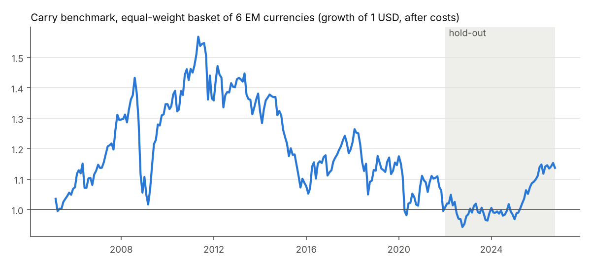
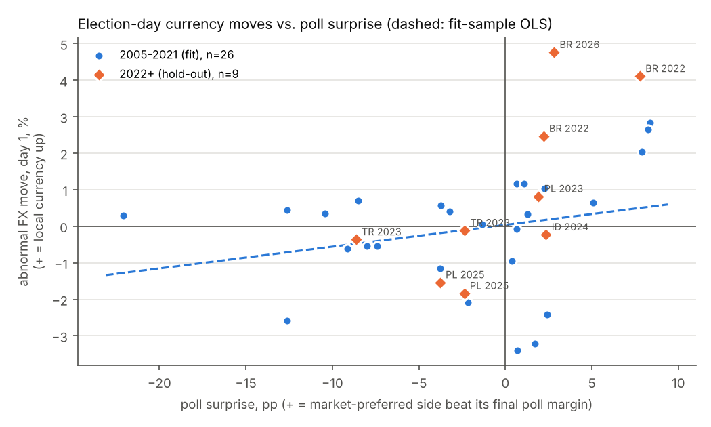

# em-macro

How emerging-market currencies and local bonds react to elections and central-bank rate decisions, for Brazil, Mexico,
South Africa, Turkey, Indonesia and Poland, 2005 to October 2026. Built only from free, public sources. Everything is
estimated on 2005–2021, and the 2022+ hold-out was evaluated once against frozen parameters.

**Short answer.**
- **Rate decisions:** policy surprises move currencies in the expected direction, but most decision days are not
  unusual.
- **Elections:** election days are unusual. Currencies move in the direction of the poll surprise, and that held up
  out of sample.
- **Drift and reversal:** the fit sample's election-reversal pattern did not survive the hold-out. The trading rule
  built on it lost money against the carry benchmark.
- **Sovereign risk model (§8–9):** the project now also covers 13 countries with a monthly panel and a sovereign
  risk model, fitted on 2005–2019 and tested once on 2020+. It explains spread levels reasonably well within each
  country. Its mispricing signal and past-cases finder do **not** forecast 3- or 6-month spread changes better than
  "no change".
- **Systematic macro strategy (§10):** carry, trend and value across currencies and 10-year bonds of the 13
  countries.
  - **Design:** set on 2005–2019 and frozen.
  - **Test, 2020 to Sep 2026:** +6.0% a year, Sharpe 0.65, worst drawdown −18%.
  - **Comparison:** simply holding the EM carry basket made −0.5% a year over the same period.
  - **What drove it:** almost all the gain came from carry. Trend and value did not help.

```
pip install -r requirements.txt
python -m em_macro.run data   # download, build panel + calendars, coverage report, carry benchmark
python -m em_macro.run fit    # 2005-2021 only -> results/fit/, frozen_params.json
python -m em_macro.run test   # 2022+ with frozen parameters -> results/test/ (refuses to run twice)
python -m em_macro.figures    # README charts
python -m em_macro.repricing  # exploratory pre-election repricing (section 7)
python -m em_macro.panel      # 13-country country-month panel + coverage report (section 8)
python -m em_macro.calendar   # 13-country dated event calendar + coverage report (section 8)
python -m em_macro.risk_model data      # lagged design matrix (section 9)
python -m em_macro.risk_model fit       # 2005-2019 only, freezes parameters (v1; add --v2 for the post-hoc version)
python -m em_macro.risk_model test      # 2020+ once, with frozen parameters (refuses to run twice)
python -m em_macro.risk_model outputs   # fair value, factor contributions, similar cases, what-if, dashboard files
python -m em_macro.systematic fit       # systematic strategy: design on 2005-2019, frozen (section 10)
python -m em_macro.systematic test      # 2020+ once
python -m em_macro.systematic update    # this month's positions + paper P&L (run monthly by GitHub Actions)
pytest -q
```

---

## 1. Data

All series are in `data/processed/daily_panel.csv`, one row per weekday from 2005-01-03 to 2026-10-29. Full coverage
statistics and cross-checks are in [`results/coverage_report.md`](results/coverage_report.md).

| What | Source (free, no API key) | Notes |
|---|---|---|
| Spot FX vs USD: BRL, MXN, ZAR | FRED H.10 (`DEXBZUS`, `DEXMXUS`, `DEXSFUS`), noon New York | Cross-checked against BCB PTAX, Banxico FIX and SARB: 5-day return correlations 0.97, 0.98 and 0.88 |
| Spot FX vs USD: TRY, IDR, PLN | Yahoo Finance (`TRY=X`, `IDR=X`, `PLN=X`) | Not in H.10. Isolated bad ticks removed (6 for IDR). PLN cross-checked against the NBP fixing (5-day correlation 0.90). Yahoo has a 26-day gap in IDR/PLN in Aug 2008 |
| 10y yield, Brazil | Tesouro Direto (Tesouro Transparente) NTN-F rates | Interpolated to 10y. Before ~2007 the longest NTN-F was shorter (maturity recorded in `Y10MAT_BR`) |
| 10y yield, Mexico | Banxico SIE vector of on-the-run Bonos M (7–10y bucket) | Yield to maturity computed from dirty price, coupon and days to maturity. Matches OECD monthly with correlation 0.99 and a −4bp mean gap |
| 10y yield, South Africa | SARB `CMJD004A`, daily average yield on bonds of 10y and longer | Matches OECD monthly with correlation 1.00 |
| 10y yield, Poland | Treasury BondSpot Poland daily fixing, every fixed-rate bond | Interpolated to 10y. Matches OECD monthly with correlation 0.9998 |
| 10y yield, Turkey | Borsa Istanbul debt-market bulletins, **from July 2018 only** | Compound yield of the traded TRY fixed-coupon bond closest to 10y. CPI-linkers and off-market prints removed |
| 10y yield, Indonesia | **none found** | No free, keyless daily history: PHEI shows only 2 days, DJPPR only PDFs, IDX blocks access |
| Policy rates (6 countries + US) | BIS `WS_CBPOL`, daily | |
| Market short rates | BCB CDI, Banxico TIIE-28, SARB JIBAR-3M | Used in the carry sensitivity check |
| US 10y, VIX, fed funds | FRED `DGS10`, `VIXCLS`, `DFF` | |
| Dollar index | Yahoo `DX-Y.NYB` (ICE DXY); FRED broad dollar as a cross-check | |

Raw downloads are cached in `data/raw/` (gitignored) and recreated by `run data`.

## 2. Carry benchmark — the bar to beat

The strategy goes long each currency against USD, earning the local policy rate minus US fed funds. It rebalances
monthly, and every month is charged a 0.10% round-trip cost:
`r_t = S_{t-1}/S_t·(1 + i_loc·τ) − (1 + i_us·τ) − 0.001`, where S is local currency per USD.
These are excess returns, so Sharpe = mean/sd·√12. The basket is the equal-weight average of the available currencies.



| series | period | months | ann. return % | ann. vol % | Sharpe | max drawdown % |
|---|---|---|---|---|---|---|
| Brazil | 2005-2021 (fit) | 203 | 3.4 | 15.8 | 0.29 | -46.4 |
| Brazil | 2022- (hold-out) | 57 | 9.9 | 12.1 | 0.84 | -18.0 |
| Mexico | 2005-2021 (fit) | 203 | -0.4 | 11.6 | 0.03 | -37.9 |
| Mexico | 2022- (hold-out) | 57 | 6.8 | 8.9 | 0.79 | -18.0 |
| South Africa | 2005-2021 (fit) | 203 | -1.7 | 15.7 | -0.03 | -49.8 |
| South Africa | 2022- (hold-out) | 57 | 1.3 | 11.8 | 0.17 | -24.4 |
| Turkey | 2005-2021 (fit) | 203 | -4.8 | 16.7 | -0.20 | -73.7 |
| Turkey | 2022- (hold-out) | 57 | -1.3 | 12.6 | -0.03 | -44.4 |
| Indonesia | 2005-2021 (fit) | 197 | 2.0 | 12.7 | 0.22 | -27.5 |
| Indonesia | 2022- (hold-out) | 57 | -4.3 | 6.2 | -0.69 | -20.7 |
| Poland | 2005-2021 (fit) | 203 | -1.1 | 13.5 | -0.02 | -45.5 |
| Poland | 2022- (hold-out) | 57 | 1.3 | 10.5 | 0.18 | -15.4 |
| **Equal-weight basket** | **2005-2021 (fit)** | 203 | **0.0** | 10.9 | **0.06** | **-37.4** |
| **Equal-weight basket** | **2022- (hold-out)** | 57 | **2.6** | 5.9 | **0.46** | **-10.1** |
| Equal-weight basket | full | 260 | 0.6 | 10.0 | 0.11 | -39.9 |

Swapping in market short rates (CDI, TIIE-28, JIBAR-3M) changes the basket by at most 0.1pp a year.

Full table: [`results/carry_benchmark.csv`](results/carry_benchmark.csv). Monthly returns:
`data/processed/carry_monthly_returns.csv`.

After costs, carry earned nothing for 17 years, with a 37% drawdown. It then had a good 2022–26.

## 3. Event calendar

All events are in `data/events/`. Every row cites its source URL, and the method notes for each research file sit
next to it in `data/events/raw/*_NOTES.md`.

**Elections: 67 votes, 66 event days.** Each two-round contest has a row for each round.

| | BR | MX | ZA | TR | ID | PL |
|---|---|---|---|---|---|---|
| votes | 13 | 10 | 4 | 16 | 6 | 18 |

The calendar covers:
- presidential, legislative and general elections, with first rounds and run-offs;
- referendums;
- Turkey's nationwide local elections and the 2019 Istanbul re-run;
- Mexico's 2021–22 popular consultations and its 2025 judicial election.

Each row records:
- the two leading candidates or parties, ranked by the final polls;
- the final pre-election poll margin, from a poll average where one exists, otherwise the mean of each pollster's last
  poll, with the basis recorded;
- the official result margin;
- where available, prediction-market or betting odds;
- a judgment code for which side financial press called market-friendly, with a citation.

Surprise measures:
- **poll error** = actual margin − final poll margin (pp);
- **signed surprise** = poll error, oriented so that + means the market-preferred side beat its polls. 27 fit-sample
  elections are coded; the rest are judged not clear-cut;
- **odds surprise** = outcome − pre-vote probability. Odds exist only for 8 votes, all in 2022+, so this measure is
  reported but cannot be fitted.

**Rate decisions: 1,251 announcements.** These are all decisions, including holds and unscheduled moves:

| | BR | MX | ZA | TR | ID | PL |
|---|---|---|---|---|---|---|
| decisions | 178 | 197 | 135 | 251 | 260 | 230 |
| with a market expectation | 166 | 30 | 35 | 21 | 22 | 114 |

How the calendar was built and checked:
- **Brazil** comes from the BCB Copom history API. Its expectation is the median Selic for that meeting in the BCB
  **Focus** survey, taken from the last survey before the meeting.
- **Other countries** come from central-bank release archives, with news sources filling gaps (flagged in the notes).
  Expectations come from Bloomberg or Reuters consensus figures quoted in free sources: Deutsche Bank Polska dailies
  for Poland, Anadolu Agency surveys for Turkey, and Reuters polls quoted by Kontan for Indonesia.
- **BIS cross-check:** every hike and cut was checked against the BIS policy-rate series. One BIS error was found
  (Indonesia, Nov 2014) and one missed emergency hike (Indonesia, Aug 2005).
- **Known gaps:**
  - About 15 Polish hold meetings in 2005–06 are missing.
  - The March 2011 Bank Indonesia meeting is undated.
  - Mexico's 2005–07 "corto" announcements are coded as hikes or cuts by interpretation.
  - Turkey's 28-May-2018 change of operating framework is flagged `technical` rather than counted as a +850bp hike.
- **Surprise:** actual change − expected change, in bp.

## 4. Method

**Timing:** for an event dated *d*:
- **base** is the last weekday before *d*;
- **day h** is the h-th weekday after *d*;
- a move at h is level(day h) − level(base).

So "day 1" covers the event day plus the next session. This captures Sunday votes (Friday to Monday), Copom's
after-close announcements, and intraday decisions alike, even though FX snapshot times differ by source. A window
end must be a fresh observation dated after the base. Units are % change in the local currency's USD value
(+ = appreciation) and bp change in the 10y yield.

**Abnormal moves:**
- **Model:** for each series, `y = a + b1·ΔDXY + b2·ΔUS10y + b3·ΔlogVIX + e`, estimated on non-overlapping 5-day
  changes over **2005–2021 only**, and applied unchanged to hold-out events.
- **Abnormal move:** the actual move minus the move predicted from the same-window factor moves (`results/fit/factor_betas.csv`).
- **Statistics:**
  - a cross-sectional t;
  - a standardised z, where each move is divided by its normal-time residual sd (Boehmer-style);
  - a **variance ratio**: mean(abnormal²)/normal variance, where >1 means event days move more than ordinary days.

**Surprise regressions** (OLS, robust SE):
- election moves on the signed poll surprise;
- |election move| on |poll error|;
- decision moves on the rate surprise, pooled and by country.

**Drift vs reversal:**
- **Regression:** `move(day1→day h)` on `move(base→day1)`, both scaled by normal-time sd. A positive slope means drift
  (continuation); a negative slope means reversal.
- **Raw-move version:** the same regression on unadjusted moves. These are tradeable, because the raw day-1 move is
  known at the day-1 price.
- **Placebo:** the same regression on ~2,800 non-event "placebo" days, to separate event-specific behaviour from
  generic short-term reversal and timing artefacts.

**Hold-out discipline:**
- **What fit sees:** only events whose 20-day window closes by 2021-12-31, and only factor data through 2021.
- **What is frozen:** everything the test needs — betas, regression coefficients and the trading rule — is in
  `results/fit/frozen_params.json`. It was committed before the test ran (commit `08c4f07`).
- **Pre-registered rule:** for each event type, trade FX from day 1 to day 5 (or day 20), in the direction of the
  fit-sample raw drift slope, *only if that slope has p < 0.10*. Each trade earns the rate differential and is charged
  0.10% round trip. Result: elections are traded as **fade the day-1 move**; rate decisions are not traded.
- **One disclosed re-run:** after the first hold-out evaluation I found a data-alignment bug. When a country's own
  series had no fresh print, a window end silently reused the base-day price. Examples are FRED's BRL series ending
  on 23-Oct-2026, and US holidays.
  - The fix changed two fit-sample rows (EL_BR_20181007 FX, RD_ID_20080805 FX) and did not change the trading rule.
  - Fit and test were re-run once.
  - The first run is kept in `results/test_run1_superseded/`. Its strategy results are identical, and its
    regression numbers differ only through the dropped Brazil run-off FX row.

## 5. Findings — fit sample, 2005–2021

All files are in `results/fit/`. Moves are abnormal unless marked raw.

**Rate decisions.**

Currencies respond to the direction of the decision, but holds are non-events:

| FX, day 1 | n | mean % | t | variance ratio |
|---|---|---|---|---|
| hikes | 137 | +0.56 | 4.1 | 2.0 |
| cuts | 227 | −0.17 | −1.9 | 1.4 |
| holds | 611 | −0.02 | −0.5 | 0.9 |

- **All decisions together:** the variance ratio is only 1.17. Most decisions are anticipated.
- **Surprises do move markets:**
  - **Brazil** (Focus, n=127): BRL gains 0.016% per bp of hawkish surprise on day 1 (t=1.9) and 0.028% by day 5
    (t=2.7). A 25bp surprise is worth about 0.4–0.7%.
  - **10y yields respond to surprises** in Mexico (+0.50bp per bp, t=6.1), Poland (+0.30, t=4.4) and South Africa
    (+0.28, t=2.4).
  - **Pooled across all countries** the FX effect is weak (t=1.3). Expectation coverage outside Brazil and Poland is
    thin and partly qualitative.
- **Long yields after hikes:** they fall 5bp on day 1 (curve flattening, t=−2.0), then rise 15bp by day 20 (t=2.8).

**Elections.**
- **Yields** move clearly. Day-1 10y yields fall 10.8bp on average (n=35, t=−2.6, z=−2.4), consistent with uncertainty
  resolving. General elections fall 17bp (t=−2.0), with a variance ratio of 4.
- **Currencies** on general elections (presidential and congressional votes together) have a day-1 variance ratio of
  2.2. They gain +2.1% by day 5 (n=12, t=4.7), but n is small.
- **Signed poll surprise:**
  - **FX:** +0.06% per pp, not significant in-sample (t=1.3, n=26).
  - **Yields:** −2.4bp per pp (t=−2.0, n=17). When the market-preferred side beats its polls, yields fall.
- **The size of the poll miss** does not predict the size of the move (|move| on |poll error|: t=−1.4).

**Drift vs reversal** (slope of day 1→5 on day 1; t in parentheses):

| | abnormal | raw | placebo days (raw) |
|---|---|---|---|
| FX, elections | −0.46 (−2.1) | −0.55 (−2.0) | 0.00 (0.0) |
| FX, rate decisions | −0.25 (−3.9) | −0.08 (−1.2) | — |
| 10y, elections | +0.47 (3.1) | +0.39 (2.7) | +0.15 (1.7) |
| 10y, rate decisions | +0.06 (0.7) | +0.13 (1.5) | — |

- **Rate decisions:** the apparent FX reversal is mostly an artefact of the factor adjustment, mixing noon-NY FX with
  end-of-day US factors. On raw moves it is small and insignificant, and placebo days show the same adjusted pattern
  (−0.06 at h=5, −0.26 at h=20).
- **Elections:** in-sample, currencies **reverse** part of their day-1 move. Bond moves **continue**.

Applying the pre-registered fade-the-day-1-move rule to elections in-sample earns +1.0% a year with a Sharpe of 0.23
(50 trades). That beats in-sample carry (Sharpe 0.06), but the rule was chosen on the same data.

## 6. Hold-out, 2022 to Oct 2026 — evaluated once

All files are in `results/test/`.

**Trading rule vs carry** (`strategy_vs_carry.csv`, monthly, 2022-01 to 2026-09):

| | ann. return % | Sharpe | max DD % | trades | hit rate |
|---|---|---|---|---|---|
| carry basket (the bar) | +2.6 | 0.46 | −10.1 | — | — |
| fade election day-1 move, hold to day 5 | −3.3 | −1.00 | −15.7 | 14 | 29% |
| fade election day-1 move, hold to day 20 | −4.8 | −0.53 | −26.2 | 14 | 43% |

**The rule fails.** Hold-out election FX moves *continued* rather than reversed: the raw slope is +0.46 (t=1.7, n=14).
It lost on Brazil's 2022 run-off, Turkey's 2023 run-off and Mexico's 2024 election. The in-sample reversal is best
read as a small-sample artefact, not a tradeable effect.

**What did hold up** (`oos_surprise_predictions.csv`):
- **Poll surprise and day-1 FX moves:** the frozen fit-sample regression predicts the hold-out moves with a
  correlation of 0.72, the right sign in 8 of 9 elections, and an out-of-sample R² of 0.15 against a zero forecast.
  The cases are Brazil 2022 and 2026, Poland 2023 and 2025, Turkey 2023 and Indonesia 2024 (chart below).
- **But the fitted slope was not significant in-sample**, and 9 events is very few. Treat this as consistent evidence,
  not proof.
- **The bond-yield surprise regression did not hold up** (R² ≈ 0, correlation −0.17).
- **The rate-surprise regressions add almost nothing out of sample** (pooled FX correlation 0.18, R² 0.02).
- **Rate decisions overall:** hold-out decisions are even quieter than in-sample. The FX variance ratio is 0.82, hikes
  average +0.15% with t=0.9, and the FX drift slopes are insignificant.



**The biggest hold-out events:**
- **Brazil, 2-Oct-2022, first round:** Bolsonaro beat his polls by 7.8pp. BRL +4.1% abnormal on day 1, 10y −31bp.
- **Brazil, 4-Oct-2026, first round:** BRL +4.8%, 10y −120bp.
- **Brazil, 25-Oct-2026, run-off:** Lula beat odds that gave Flávio Bolsonaro 80%. The 10y rose +255bp on day 1. The
  FX move is outside the study because FRED's BRL ends on 23-Oct, but BCB PTAX shows BRL −8.4%.
- **Turkey, 14-May-2023:** the 10y fell 298bp on day 1 and 533bp by day 5.
- **Mexico, 2-Jun-2024:** MXN −3.5% on day 1 and −7.2% by day 5. Note this is *not* a poll miss on the presidency
  (Sheinbaum led by 17pp and won by 33pp). The worry was Morena's congressional supermajority, which a two-candidate
  margin cannot capture.

## 7. Exploratory: pre-election repricing as polls and odds move

> **Exploratory.** This section was added after the hold-out evaluation. It uses all dates, including 2022+, and is
> not part of the frozen fit/test design. Nothing in it was pre-registered, and it runs many regressions, so isolated
> significant coefficients are expected by chance.

**Question.** In the six months before a vote, do currencies and 10y yields move day by day with the leading
candidate's poll margin or win probability?

**Signals.**
- **Betting odds:** daily Polymarket prices for the 6 elections that have a stored price history.
  - Brazil 2026 (Lula), Mexico 2024 (Sheinbaum), Turkey 2023 (Kılıçdaroğlu, i.e. 1 − Erdoğan) and Poland 2025
    (Trzaskowski) price who wins.
  - Indonesia 2024 (Prabowo) and South Africa 2024 (ANC wins a seat majority) also have histories.
  - Polymarket's Brazil 2022 market has no stored history, and there were no markets for earlier votes.
  - For markets that price the eventual winner, the window runs on to the run-off. The round-1 result day is dropped
    (it is the election-day event in §4–6).
- **Polls:** 2,497 poll rows compiled from Wikipedia poll tables (exact page revisions cited). Files:
  `data/events/raw/prevote_polls_*.csv` and their NOTES.
  - **Daily poll-of-polls:** the mean, across pollsters, of each pollster's latest released poll from the last 30 days.
  - **Release date:** fieldwork end + 1 day where no publication date is given (almost always).
  - **Two-party margin:** 100·(a−b)/(a+b). Bases (total, decided, valid) are mixed within elections, so two-party
    shares keep polls comparable.
  - **Eligibility:** ≥1 poll per week over the window. Brazil 2018 scenarios with Lula as the candidate are excluded.
  - **Head-to-head run-off simulations** fielded before round 1 are a separate signal (Brazil 2018/22/26, Poland 2025,
    Turkey 2023).
  - **What qualified:** 21 elections with a first-round/single-round poll signal and 5 with a head-to-head signal.
    Poland 2020 qualified but the window is too short to estimate.
- **Orientation:** every signal is oriented to the **leading candidate** (`cand_a` in `elections.csv`). For pooling
  and sign checks it is re-oriented toward the side the press called market-preferred, where that is coded.

**Regression** (`em_macro/repricing.py`):
`ΔFX_d (or Δy10_d) = a + b·ΔS_d + c1·ΔDXY_d + c2·ΔUS10y_d + c3·ΔlogVIX_d`, on weekdays, with HAC(5) standard errors.
- **Sensitivity units:** FX % (+ = local currency up) or bp, per **1pp of two-party poll margin** or per **10pp of win
  probability**.
- **Lead/lag:** a distributed lag of ΔS from 5 days before to 5 days after. Sums over the 5 future signal changes mean
  the market leads; sums over the 5 past changes mean it lags.
- **Partial reversal:** local projections of the cumulative move from d−1 to d+h (h = 0…10) on ΔS_d. The share of the
  day-0/1 response still present at h = 10 is computed only when that initial response is significant.

**Brazil 2022 and Mexico 2024** (`results/repricing/sensitivity_leadlag.csv`; t in parentheses):

| | signal | FX % per unit | 10y bp per unit | currency leads (Σ leads) | currency lags (Σ lags) |
|---|---|---|---|---|---|
| Brazil 2022 (Lula − Bolsonaro) | poll margin, per 1pp | −0.01 (−0.1) | −2.3 (−2.5) | FX −0.10 (−0.6); 10y +9.9 (2.8) | FX −0.41 (−2.6); 10y +3.8 (1.0) |
| Brazil 2022 | run-off simulation, per 1pp | −0.02 (−0.2) | −2.7 (−2.4) | FX −0.25 (−1.2); 10y +9.2 (2.4) | FX −0.46 (−2.3) |
| Mexico 2024 (Sheinbaum − Gálvez) | poll margin, per 1pp | 0.00 (0.4) | +0.2 (1.0) | FX −0.02 (−0.7) | FX −0.05 (−1.9); 10y +0.6 (2.6) |
| Mexico 2024 | Polymarket, per 10pp | −0.14 (−1.0) | +0.1 (0.1) | FX −0.40 (−0.6) | FX +0.33 (0.6) |

- **Mexico 2024** shows nothing: Sheinbaum led by a wide margin and was priced at about 93% throughout, so neither signal
  carried news.
- **Brazil 2022** shows no same-day BRL response to polls. One item fits a delayed reaction: a Lula gain is followed
  by a weaker BRL over the next five days (Σ lags −0.41% per pp, t=−2.6).
- **Brazil 2022 10y yields** go the "wrong" way on the day: −2.3bp per pp of Lula margin. Their lead terms go the other
  way (+9.9bp, t=2.8). This sign flip, combined with Tesouro Direto's morning quote times, points to timing noise, or
  to a common cause, rather than a clean poll effect. The mid-2022 fiscal package moved Bolsonaro's polls and yields at
  the same time.

**All elections** (`results/repricing/evidence_counts.csv`, `pooled.csv`; significance means |t| ≥ 1.96):

| signal / asset | elections | same-day b significant | expected sign¹ (of coded) | expected sign & significant | market leads signif. | market lags signif. |
|---|---|---|---|---|---|---|
| odds / FX | 6 | 0 | 1 of 4 | 0 | 1 | 1 |
| odds / 10y | 5 | 1 (South Africa) | 1 of 3 | 0 | 1 | 1 |
| polls / FX | 21 | 0 | 10 of 17 | 0 | 3 | 5 |
| polls / 10y | 15 | 1 (Brazil 2022, wrong sign) | 5 of 12 | 0 | 4 | 2 |
| run-off sims / FX | 5 | 0 | 3 of 5 | 0 | 2 | 1 |
| run-off sims / 10y | 5 | 1 (Brazil 2022, wrong sign) | 1 of 5 | 0 | 2 | 0 |

¹ "Expected sign" means the local currency rises, or the yield falls, as the market-preferred side gains.

**Pooled** (oriented toward the market-preferred side, election-specific controls):

| signal | elections | FX per unit | t |
|---|---|---|---|
| polls | 17 | +0.017% per pp | 0.9 |
| run-off simulations | 5 | −0.006% per pp | −0.2 |
| odds | 4 | −0.11% per 10pp | −1.6 |

**Reading.**
- **Sensitivity:** no election shows a significant same-day currency response to poll or odds changes. Signs split
  roughly 50/50 around the market-friendly hypothesis: 10 of 17, 3 of 5 and 1 of 4. The largest point estimates are
  economically small:
  - **Brazil 2026:** −0.46% BRL per 10pp rise in Lula's win probability, t=−1.9. This has the expected sign, since
    Flávio Bolsonaro was coded market-preferred.
  - **Poland 2025:** −0.30% PLN per 10pp for Trzaskowski, t=−1.9. This is the wrong sign.
- **The only significant same-day coefficient** is South Africa 2024: the 10y falls 2.6bp per 10pp of ANC-majority
  probability (t=−5.1). It rests on 32 trading days of a thin market.
- **Lead/lag:** significant lead sums appear in 1–4 elections and lag sums in 0–5 per signal/asset row, with no
  consistent direction. For polls this is also limited by dating: fieldwork end + 1 is only a proxy for when a poll
  became public. For FX against odds, FRED's noon-New-York FX predates Polymarket's end-of-day (UTC) price, which by
  itself would make FX look one day late. **No conclusion about leading or lagging is supported.**
- **Partial reversal:** the initial response is significant in only 1–2 elections per row. Among those, only 1 (polls,
  FX) gives back half or more within 10 days. **There are too few events to say anything about reversal.**
- **Bottom line:** with free daily polls and odds, pre-election repricing is not detectable day by day in these six
  markets. The election-day jump (§5–6) is where the information shows up.

**Caveats specific to this section.**
- **Odds history:** Polymarket covers only 2023–26, and several markets were thin (South Africa, Indonesia,
  Mexico 2024).
- **Turkish lira:** TRY was heavily managed in 2023, so FX sensitivities there are mechanically near zero.
- **Poll timing and noise:** fieldwork-to-publication lags vary. The daily poll average jumps when a pollster with a
  large house effect publishes.
- **What the regressions measure:** association, not causation. Campaign news, fiscal announcements and global shocks
  move polls and markets together.

## 8. Extension: 13-country panel and event calendar (data)

**Countries.**
- **The original six:** Brazil, Mexico, South Africa, Turkey, Indonesia, Poland.
- **Added:** France, Italy, Spain, United Kingdom, Colombia, Chile.
- **European benchmark:** Germany.

**Focus countries** for later outputs: **Brazil, Mexico, France** (`focus = True` in the panel).

**Outputs.**
- `data/processed/country_month_panel.csv`: 13 countries × 262 months (2005-01 to 2026-10), 78 factors.
- `results/panel_coverage.md`: coverage by factor and country. Each cell is the % of months with a value, with
  first and last months; the source and caveats for every column are listed there too. A machine-readable copy is
  `data/processed/panel_coverage.csv`.
- `data/events/calendar_13.csv`: 2,755 dated events, all with a source URL. Coverage is in
  `results/calendar_coverage.md`.
- **Research inputs**, each with a NOTES or SOURCE file stating method, rules and doubtful rows:
  `data/events/raw/` (elections, government events, rating actions) and `data/external/` (politics, structural).

**Timing convention.**
- **Market data** are monthly averages; FX is also month-end.
- **Annual data** (IMF WEO, WGI, V-Dem, central bank independence) are assigned to every month of their calendar
  year; quarterly data to the months of their quarter.
- **Values are latest-vintage, not real-time.** No lags are applied, so the panel is not yet safe for forecasting
  without adding publication lags.

### Factors and sources

| block | panel columns | source |
|---|---|---|
| 10y yield and spread | `y10`; `spread_vs_de_bp`, `spread_vs_us_bp`; `spread_bench_bp` (vs Bund for FR, IT, ES, GB, PL; vs UST otherwise) | BR/MX/ZA/PL/TR: monthly means of the project's daily series (§1); FR/IT/ES/DE: ECB IRS convergence yields; GB/CO/CL/ID: OECD MEI `IRLT`; US: FRED `DGS10` |
| currency | `fx_per_usd_avg/_end`, `fx_ret_vs_usd_pct` | FRED H.10 (BRL, MXN, ZAR, EUR, GBP); Yahoo (TRY, IDR, PLN); official fixings for COP (BanRep TRM) and CLP (BCCh *dólar observado*) — Yahoo's COP history has bad prints |
| fiscal | `fiscal_balance_gdp`, `primary_balance_gdp`, `gross_debt_gdp`, `net_debt_gdp`, `debt_change_1y_pp`, `debt_change_next5y_pp` | IMF WEO via the IMF SDMX API, latest vintage (Sep 2026 country updates), projections to 2031 |
| debt holders | `debt_foreign_share_{at,qpsd,eurostat}`, `debt_fx_share_{qpsd,eurostat}` | Arslanalp–Tsuda investor base (2016 vintage, to 2016Q2), World Bank/IMF QPSD, Eurostat. One column per source: they measure different things, so they are **not spliced** |
| monetary | `policy_rate`, `cpi_yoy`, `real_policy_rate`, `inflation_target(_low/_high)`, `inflation_vs_target_pp`, `inflation_outside_band` | BIS policy rates (euro countries: BIS euro-area series) and BIS CPI. Targets: central-bank sources (`data/external/structural/inflation_targets.csv`) |
| central bank independence | `cbie_index`, `garriga_lvau`, `garriga_lvaw` | Romelli CBIE (2025) and Garriga (2025). Annual, to 2023. Garriga gives all euro members the ECB's score |
| external | `current_account_gdp`, `reserves_usd_m` (monthly), `reserves_months_imports`, `reserves_usd_annual`, `imf_programme`, `imf_facility` | IMF WEO; IMF IFS reserves via FRED; World Bank WDI; IMF lending history (`imf_programmes.csv`) |
| ratings | `rating_sp`, `rating_moodys`, `rating_fitch` (21 = AAA/Aaa … 1 = C/default), `rating_avg_outlook_adj` (outlook ±1/3, watch ±2/3), `rating_upgrades_n`, `rating_downgrades_n` | Hand-compiled histories (`rating_actions_*.csv`, 682 actions) from treasury/central-bank investor pages, agency releases, countryeconomy and Trading Economics, with cross-checks |
| government | `gov_seat_share`, `gov_n_parties`, `gov_minority`, `n_governments_prior5y` | ParlGov (to 2023) extended from Wikipedia/official pages for EU+TR; IPEA, Figueiredo, the Presidential Cabinets Project, DPI 2020 and Wikipedia for presidential systems (`data/external/politics/`) |
| party positions | `head_party_*`, `gov_parties_*` × {`lr_parlgov`, `lr_econ_ches`, `lr_econ_vparty`, `lr_econ_gps`, `populism_vparty`, `populism_gps`, `populist_popu_list`} | ParlGov expert left-right; CHES; V-Party v2 (V-Dem, to 2019 elections); Global Party Survey 2019; PopuList 4.0 (Europe only). **Manifesto Project not included** (needs an API key) |
| governance | `wgi_{va,pv,ge,rq,rl,cc}`, `vdem_{v2x_jucon,v2juhcind,v2juncind,v2x_rule,v2x_corr}` | World Bank WGI (API, to 2025); V-Dem v16 (to 2025) |
| global | `us10y`, `dxy`, `vix`, `fed_funds`, `ecb_deposit_rate`, `ecb_mro_rate` | FRED, Yahoo (ICE DXY), ECB data portal |

### Coverage of the focus countries

- **All three** are complete from 2005 for:
  - yields, spreads, FX, policy rate, CPI and inflation-vs-target;
  - WEO fiscal and external data;
  - ratings (all three agencies), government seat share, coalition size and governments in the prior five years;
  - WGI and V-Dem, through 2025;
  - central bank independence, through 2023.
- **France:**
  - **Debt held abroad:** Arslanalp–Tsuda to 2016Q2, then Eurostat from 2020, so **2016Q3–2019 is missing**.
  - **Foreign-currency share of debt:** none (immaterial for euro debt).
  - **Party positions:** ParlGov, CHES, V-Party and PopuList; the Global Party Survey does not cover France.
- **Brazil and Mexico:**
  - **Debt held abroad and in foreign currency:** World Bank QPSD from 2009Q3 (Brazil) and 2008Q1 (Mexico), plus
    Arslanalp–Tsuda 2005–2016.
  - **Party positions:** V-Party and the Global Party Survey only. ParlGov, CHES and PopuList are Europe-only.

### Main gaps and caveats

- **10y yields:**
  - Turkey only from July 2018, since no keyless source before that.
  - Indonesia only for 2012–2024 (OECD).
- **Monthly reserves** are missing for Colombia and Chile. The annual World Bank series covers them.
- **Real-time data:** WEO, WGI and V-Dem values are final, latest-vintage numbers, and imf.org's historical WEO
  vintage files were rate-limited (HTTP 429). `debt_change_next5y_pp` is **ex post**: realised history plus the
  current projections.
- **Party scores:** V-Party ends with 2019 elections, so later months carry forward each party's latest scored
  election. Many newer parties have no V-Party or Global Party Survey score.
- **Debt holders:** the three sources differ by up to ~10pp for the same quarter (UK 2010Q4: 26.2% Arslanalp–Tsuda vs
  16.8% QPSD). Chile and Colombia have no foreign-share data after 2016Q2.
- **Ratings:**
  - Changes are near-complete for most pairs.
  - Weaker coverage: UK Fitch after 2016, Spain Fitch 2019–24, and Mexico/Chile before 2016 (mostly single-source).
  - Affirmations are partial. 24 European and ~10 EM rows are flagged DOUBTFUL in the notes.
- **Government data:**
  - Seats are counted at cabinet start, with no defections.
  - Brazil's coalition spells follow IPEA and Figueiredo; 8 rows are flagged doubtful.
  - Turkey after 2018 counts People's Alliance seats.
  - ParlGov counts LR as governing under Philippe II and Castex; the alternative share is in the notes.

### Event calendar for the new countries

For France, Italy, Spain, the UK, Germany, Colombia and Chile, `calendar_13.csv` adds:

| event type | rows (new countries) | what |
|---|---|---|
| elections | 99 | all national votes with rounds, referendums, final-poll margins, odds where public, market-preferred coding |
| government collapses | 159 | resignations, censure defeats, dissolutions, snap-election calls, every new government; finance-minister changes in CO/CL |
| confidence votes | 193 | e.g. every French *motion de censure* since 2005 (with votes), Italian investitures, Spanish investiture/censure ballots, UK and German confidence votes, Chilean constitutional accusations, flagship reform votes |
| budgets | 343 | draft and final budget dates, UK fiscal events, EU excessive-deficit-procedure steps, special laws, fiscal-rule changes, IMF FCL dates |
| rating actions | 255 (+388 for the original six) | upgrades, downgrades, outlook/watch changes, partial affirmations |

Calendar gaps:
- **Rate decisions** are compiled only for the original six. ECB, BoE, BanRep and BCCh decisions are not yet in.
- **Government and budget events** are compiled only for the new countries.
- **Thin budget dates:** German annual budget dates (official sites blocked) and most Colombian and Chilean
  budget-cycle dates.
- **Prediction-market odds** exist for few of the new elections.
- **Search budget:** three research agents hit a shared web-search limit, which left the gaps above. Each NOTES
  file lists what is missing.
- **Undated rows:** five research rows have only a month and are kept in `data/events/calendar_13_undated.csv`.

## 9. Sovereign risk model (13-country panel)

> **Plain-English summary.**
> - **Explaining levels:** the model explains much of the variation in each country's spread over time (within-country
>   R² 0.57). It explains even more for currencies (0.86).
> - **Forecasting:** the gap between a spread and its model value does **not** forecast the spread's next 3 or 6
>   months better than "no change" in 2020–2026, for the pool or for Brazil, Mexico or France. Neither does the
>   past-cases finder.
> - **Specification error:** after the one-time test, the frozen model turned out to give non-credible fair values
>   for some countries (France most visibly). It treats two different kinds of spread as one. A corrected version
>   with separate equations ("v2") feeds the dashboard. v2 is **post-hoc: chosen after the 2020+ test; not a clean out-of-sample result**. Its 2020+ evaluation also fails to beat
>   "no change".
> - **Past-cases finder:** its average outcome predicted worse than "no change" out of sample, so the similar
>   cases are **for context only**, not a forecast.
>
> Treat the fair values as a description of where spreads sit relative to 2005–2019 relationships, not as a
> trading signal. The frozen event-study results (§5–6) are untouched.

### Data and look-ahead control

The design matrix is `data/processed/risk_model_input.csv`. Every factor enters with its realistic publication
delay:

| factor group | lag | how |
|---|---|---|
| IMF WEO and annual fiscal data (debt, deficit, debt trajectory, current account) | 12 months | each month uses the **previous calendar year's** value |
| World Bank governance (WGI), V-Dem judicial scores | 12 months | previous year's value |
| central bank independence (CBIE), reserves in months of imports (WDI) | 12 months | previous year's value; CBIE ends 2023 and is carried forward |
| foreign-held share of government debt (quarterly) | 6 months | my choice: these are quarterly data published with about a quarter's delay |
| monthly macro: CPI inflation (inflation gap, real policy rate) | 1 month | the policy rate itself is unlagged |
| ratings, government structure (seat share, coalition, turnover), party positions, IMF programme | none | known on the day |
| market data: US 10y, VIX, ECB deposit rate, policy-rate differential, commodity prices | none | |

Design choices:

- **Debt trajectory** is the average annual change in debt over the previous three years. The panel's
  `debt_change_next5y_pp` is not used: it is ex post.
- **Foreign-held share:**
  - Built from Arslanalp–Tsuda to 2016Q2, then extended with QPSD (or Eurostat), ratio-spliced at the last
    overlapping quarter.
  - Where there is no overlap (France, Poland), the new source is level-matched to the last earlier value.
  - After the last observation, the value is carried forward (Chile and Colombia from 2016).
- **Missing values** are carried forward within a country. Anything still missing is set to that country's
  2005–2019 average, which contributes zero.
- **Party measures that don't apply:** CHES and PopuList exist only for European parties, so they are 0 for the
  other countries.
- **Party scores and publication timing:** the identity of the governing parties is known immediately, but their
  expert scores were published after each election. This look-ahead is minor and not lagged.

### Model

**What is modelled.**
- **Spread:** the 10-year spread, monthly average, in bp.
  - **Benchmarks:** over the Bund for France, Italy, Spain, the UK and Poland; over US Treasuries for Brazil, Mexico,
    South Africa, Turkey, Indonesia, Colombia and Chile.
  - **Germany** is the benchmark and is not modelled.
  - **These are local-currency yield gaps**, so the emerging-market ones contain inflation and policy-rate
    differentials, not just credit risk.
- **Currency:** 100 × log of the real exchange rate against the USD (local per USD, deflated by CPI, so + means a
  weaker local currency). It covers the nine non-euro currencies.

**Spread equation.**
- **Fundamentals:** debt, deficit, debt trajectory, foreign-held share, central bank independence (CBIE), inflation
  gap and real policy rate.
- **Government:** seat share and the number of governments in the prior five years.
- **Governing parties:** economic left-right (V-Party, CHES) and populism (V-Party, PopuList).
- **Governance and external:** WGI governance, V-Dem judicial constraints and high-court independence, current
  account, reserves and IMF programme.
- **Rating and global factors:** average rating, US 10y, log VIX and the ECB deposit rate.
- **Interaction:** debt × government seat share (both centred on the country's own average).
- **Fixed effects:** country fixed effects.

**Currency equation.** The same factors, plus the policy-rate differential against fed funds, and log commodity
prices (all-commodity index, Brent, copper, soybeans, iron ore) with **country-specific slopes**.

**Estimation.**
- **Ridge:** on factors standardised with 2005–2019 pooled means and standard deviations, demeaned within country.
- **Penalty:** chosen by blocked cross-validation with 3-year blocks inside 2005–2019 (`results/risk_model/fit/cv_*.csv`).
- **Standard errors:** Driscoll–Kraay with a Bartlett kernel and 12 lags. They are robust to cross-country
  correlation and autocorrelation. They describe sampling noise of the shrunk estimate, not its bias towards zero.

**Mispricing and its forecast.**
- **Mispricing** = actual − fitted. `gap_z` scales it by the country's 2005–2019 residual standard deviation.
- **Forecast:** Δspread(t, t+h) = −κ_h × gap_t. κ_h was estimated on **out-of-fold** 2005–2019 gaps:
  - v1: κ₃ = 0.08 and κ₆ = 0.18, meaning 8% and 18% of a gap closes over 3 and 6 months.
  - v2: κ = 0.08–0.10 at 3 months and 0.14–0.24 at 6.

### Coefficients (fit 2005–2019; full tables in `results/risk_model/fit*/coefficients_*.csv`)

All figures are within-country associations, not causal effects. The tables list per-unit effects with
Driscoll–Kraay t-statistics.

**v1 spread equation** (one pool of 12 countries, λ = 34, within R² 0.57, n = 1,914):

| factor | effect on spread | t |
|---|---|---|
| average rating, per notch | −26bp | −5.7 |
| inflation gap, per pp | +37bp | 8.6 |
| real policy rate, per pp | +24bp | 5.8 |
| deficit, per pp of GDP | +6bp | 2.1 |
| government seat share, per pp | −1.7bp | −2.3 |
| VIX, per 10% rise | about +4.5bp | 4.3 |
| US 10y, per pp | −28bp | −4.4 |
| ECB rate, per pp | −42bp | −4.3 |
| debt, per pp of GDP | −1.4bp | −2.1 |

How to read the less intuitive rows:
- **Debt:** the negative sign is a within-country artefact. Debt ratios rose in years when local-currency spreads
  compressed.
- **US 10y:** partly mechanical, since a higher Treasury yield narrows a spread measured over Treasuries.
- **Debt × seat share:** +58bp per joint standard deviation (t = 3.5).
- **Party positions:** the populism and party-position terms are small or of mixed sign.

**v2 equations — **post-hoc: chosen after the 2020+ test; not a clean out-of-sample result**.**
- **Spreads over Bunds** (France, Italy, Spain, UK, Poland; within R² 0.82):
  - rating −37bp per notch (t −7.7);
  - deficit +9bp per pp of GDP (t 5.0);
  - inflation gap +30bp per pp;
  - current account −10bp per pp of GDP;
  - debt × seat share −30bp per joint SD (t −5.1).
  - Here the interaction means high debt hurts most when the government's seat share is low.
- **Spreads over US Treasuries** (seven emerging markets; within R² 0.50):
  - rating −10bp per notch (t −3.5);
  - inflation gap +22bp per pp;
  - real rate +16bp per pp;
  - deficit +5bp per pp of GDP (t 1.9);
  - VIX +7bp per 10% rise.
- **Penalty:** the cross-validated penalty for the European equation sits at the bottom of the grid (λ = 0.9), so
  that equation is barely shrunk.

**Currency equation** (v1, nine currencies, within R² 0.86). The local currency is weaker in real terms with:
- higher debt: +0.33% per pp of GDP (t 11.0);
- a higher foreign-held share: +0.35% per pp;
- a higher inflation gap: +1.4% per pp;
- an IMF programme: +3.1%.

It is stronger with stronger judicial constraints (t −9.3) and a better rating (−0.8% per notch).

### One-time test, 2020 onward (`results/risk_model/test/`, v1 as specified)

The forecast of each spread change is −κ × gap. It is compared with "no change" by RMSE ratio (below 1 means the
model is better) and a Diebold–Mariano t-statistic (positive means better), and also after dropping the five
largest moves.

| v1 spread mispricing | 3 months: RMSE ratio (DM t) | without top-5 moves | 6 months: RMSE ratio (DM t) | without top-5 moves |
|---|---|---|---|---|
| all 12 countries | 1.00 (−0.2) | 1.01 (−0.5) | 0.98 (0.6) | 1.01 (−0.4) |
| **Brazil** | 0.99 (1.1) | 0.99 (1.1) | 0.98 (0.5) | 0.97 (0.9) |
| **Mexico** | 0.99 (0.9) | 0.99 (0.7) | 0.98 (0.6) | 1.00 (0.0) |
| **France** | 1.59 (−3.3) | 1.72 (−3.4) | 2.34 (−3.6) | 2.44 (−3.5) |

- **Brazil and Mexico:** at best 1–3% better than no change, not significant.
- **France:** far worse. Its spread kept widening in 2024–26 while the v1 model put its fair value far below.
- **The 6-month pooled edge (0.98)** disappears once the five largest moves are removed.
- **Other countries:** the only ones with a gain of 5% or more are South Africa (0.88 at 6 months, DM 1.7) and
  Indonesia (0.92). Spain and France are clearly worse.
- **Currency mispricing** is worse than no change (pooled 1.04 and 1.10). Mexico is 0.95–0.99; Brazil is 1.09–1.29.

**v2** (`results/risk_model/test_v2_posthoc/`) — **post-hoc: chosen after the 2020+ test; not a clean out-of-sample result**:

| | 3 months | 6 months |
|---|---|---|
| pooled | 1.00 (DM −0.3) | 0.98 (DM 0.3) |
| pooled, without top-5 moves | 1.01 | 1.02 |
| Brazil | 0.98 | 0.97 |
| Mexico | 0.99 | 0.97 |
| France | 1.08 | 1.18 |

v2 fixes France's level problem but does not create forecasting power.

**Conclusion: no version of the mispricing signal beats no-change out of sample, and nothing survives removing the
largest moves.**

### Past-cases finder (`results/risk_model/similar_cases.csv`)

**How it works.**
- **Factors compared:** the 17 lagged country factors (fiscal, monetary, government, party, governance, external,
  rating), each standardised with 2005–2019 pooled means and SDs.
- **Distance:** RMS over factors both cases have, with at least 8 shared.
- **Candidates:** other countries' months up to the query month, or the same country more than 24 months earlier.
- **Spacing:** at most one case per country within any 12-month window.
- **Output:** for each country-month since 2007, the five nearest cases. Each comes with its spread and currency
  moves over the next 3, 6 and 12 months, shown "n/a" where they were not yet known at the query date.

**Out-of-sample validation, 2020+.** Only cases whose outcome was already known are used. The average of the five
cases' moves is **worse than no change**:

| | 3 months | 6 months |
|---|---|---|
| spreads | 1.04 (DM −2.4) | 1.05 (DM −2.9) |
| currencies | 1.09 (DM −3.3) | 1.05 (DM −1.7) |

It is worse for Brazil, Mexico and France too, except Mexico's currency (0.96, not significant). **The similar
cases are for context only, not a forecast.** `similar_cases.csv` says so in its `asset` column and at the end of
every `outcome_note`.

### What-if tool (`results/risk_model/what_if.csv`; latest month; 90% bands from the Driscoll–Kraay covariance)

These are the model's estimated **level** shifts, holding every other factor fixed.

| scenario | France spread, bp | Brazil spread, bp | Mexico spread, bp |
|---|---|---|---|
| government loses its majority¹ | +19 [9, 29] | −31 [−59, −2] | −30 [−69, +10] |
| deficit +1pt of GDP | +9 [6, 12] | +5 [1, 9] | +5 [1, 9] |
| one-notch downgrade | +37 [29, 45] | +10 [5, 15] | +10 [5, 15] |
| populism +1 SD (V-Party) | +12 [−9, +34] | 0 [−4, +4] | 0 [−4, +4] |

¹ France (28%) and Brazil (48%) already govern without a majority, so for them the scenario is a further 10-point
fall in seat share. Mexico's coalition goes to 45%.

Currency effects for Brazil and Mexico (v1 currency equation; + = weaker in real terms):

| scenario | Brazil | Mexico |
|---|---|---|
| loses majority | +2.8% | +4.1% |
| deficit +1pt | −0.5% | −0.5% |
| downgrade | +0.8% | +0.8% |
| populism +1 SD | +1.5% | +1.5% |

How to read the scenarios:
- **Same estimate in every country:** a linear model gives every country in an equation the same effect for the
  same shock. Only the majority scenario differs, through the debt × seat-share interaction.
- **Negative seat-share effect in Brazil and Mexico:** this reflects 2005–2019 co-movement in the emerging-market
  equation. Broad coalitions coincided with higher local-currency yields. It is not a causal estimate.
- **Bands** cover parameter uncertainty only, not model uncertainty.

### Dashboard files

These follow forecast-panel `site/config.yaml`; the country column holds ISO3 codes and dates are YYYY-MM-01.

| file | columns | content |
|---|---|---|
| `results/risk_model/fair_value.csv` | `country,date,asset,actual,fair_value,gap,gap_z` | v2 spread fair values, **post-hoc: chosen after the 2020+ test; not a clean out-of-sample result**. The `asset` value carries this label so the dashboard shows it next to each fair value |
| `results/risk_model/factors.csv` | `country,date,asset,factor,contribution` | bp, from 2015; contributions are measured against the country's 2005–2019 average and, with the "baseline" row, sum to the fair value |
| `results/risk_model/similar_cases.csv` | `country,date,asset,case_country,case_date,similarity,outcome_note` | similarity = 1/(1 + RMS distance). **Context only:** the past-cases average predicted worse than no-change out of sample. This note is in the `asset` column and at the end of each `outcome_note` |

Other files:
- `what_if.csv`: the scenario estimates above.
- `fx_fair_value.csv`, `fx_factors.csv`: the v1 currency equation. Not shown on the dashboard, because its
  out-of-sample levels are not credible (see below).
- `v1_frozen/`: the as-specified v1 spread outputs.

### Limitations

- **Out-of-sample fair values drift:**
  - **Spreads (v2):** in 2026, Italy sits 213bp below fair value (z −5.3), the UK 212bp above (z 6.1) and Turkey
    1,364bp above. ECB backstops, the UK's 2022 shock and Turkey's 2023–26 policy regime are outside the 2005–2019
    experience.
  - **Currencies:** the BRL fair value (2.9 per USD against 5.1 actual) comes from commodity prices far above their
    2005–2019 range, extrapolated through Brazil's own commodity slope.
- **Data limits:**
  - **Short histories:** Turkey's spread has only 18 months in the fit sample, and Indonesia's spread ends in 2024.
  - **Latest-vintage annual data:** they are lagged 12 months but are not the real-time vintages.
  - **Assumptions in the inputs:** foreign-share splices and carry-forwards are assumptions. V-Party scores end with
    2019 elections, and the Manifesto Project is unavailable.
- **Modelling limits:**
  - **Collinearity:** coefficients are within-country associations among collinear factors. V-Dem judicial
    constraints and high-court independence take opposite signs.
  - **Bands:** ridge shrinks towards zero, and the Driscoll–Kraay bands do not account for that bias.
- **What the test can and can't say:**
  - **Small samples:** about 75–80 overlapping monthly forecasts per country, so per-country DM statistics are noisy.
  - **v2 is **post-hoc: chosen after the 2020+ test; not a clean out-of-sample result**.** Its numbers are not an independent test.

## 10. Systematic macro strategy

> **Plain-English summary.**
> - **What it does:** each month the strategy ranks 10 currencies and 13 bond positions by three signals:
>   - **carry:** how much they pay;
>   - **trend:** how they have performed;
>   - **value:** how cheap they look.
>
>   It buys the best third, sells the worst third, sizes every position to the same risk and runs the whole book at
>   10% volatility, after realistic trading costs.
> - **Testing:** every rule was fixed on 2005–2019 data and frozen (commit `2dbfeb1`), then tested once on
>   Jan 2020 to Sep 2026.
> - **Result:** the combined strategy made **+6.0% a year (Sharpe 0.65)**, with a worst fall of 18% and slightly
>   negative correlation with US stocks (−0.17). Simply holding the emerging-market carry basket made −0.5% a year.
> - **Caveats:** the edge came almost entirely from carry; trend was flat and value lost money. Leverage is high
>   (about 5.5× gross on average) and bond returns are approximations from monthly-average yields. Treat this as a
>   research backtest, not a ready-to-trade product.

### What it trades

| book | instruments | return measured as |
|---|---|---|
| currencies (10) | BRL, MXN, ZAR, TRY, IDR, PLN, GBP, COP, CLP and EUR (once, for France, Italy, Spain and Germany), each against USD | spot move plus local policy rate minus US fed funds, month-end to month-end |
| bonds (13) | 10y local-currency bonds of Brazil, Mexico, South Africa, Turkey, Indonesia, Colombia and Chile; 10y spreads over the Bund for France, Italy, Spain, UK and Poland; the Bund itself | excess return over the funding rate: (yield − funding)/12 − duration × yield change + convexity term. Funding is the local policy rate; for spreads it is the Bund; for the Bund it is the ECB rate |

Bonds start trading once they have 12 months of data: Turkey from mid-2019, Indonesia from 2013. Indonesia's
yields stop at Dec 2024, so its bond drops out from 2025.

### Signals, portfolio and costs

| | rule |
|---|---|
| carry | currencies: local policy rate minus US fed funds. Bonds: 10y yield minus policy rate; spread level for the European spreads; Bund yield minus ECB rate |
| trend | average of the cross-country z-scores of the past 12-month and 3-month return |
| value | currencies: log real exchange rate (CPI lagged one month) minus its 5-year average, with at least 3 years required. Positive means cheap. Bonds: the risk model's **v1 frozen** mispricing (spread minus fair value; positive means cheap). The Bund has no value signal |
| combine | each signal is z-scored across the instruments of a book every month; the three are averaged equally |
| select | rank each book; long the top third and short the bottom third |
| size | each position gets 1/(its trailing 36-month volatility). Each book is scaled to 10% volatility on its trailing 36-month history, the two books are mixed 50/50, and the total is rescaled to 10% |
| limits | gross leverage capped at 6× on target positions. **No-trade band:** keep a position unless its target moves by more than 25% (exits and sign flips always trade) |
| costs | 0.1% of notional traded for major currencies and bonds; 0.3% for Turkey, Indonesia, Colombia and Chile. Spread trades pay twice (two bonds) |
| timing | currency positions decided at month-end earn the next month's return. Bond yields are monthly averages, so bond positions earn the change between the next two monthly averages. This one-month delay avoids using information from inside the month |

**How the design was chosen (2005–2019 only).** Almost all the rules above are yours or were fixed in advance. I
tried exactly one alternative: the no-trade band (none vs 25%). On 2005–2019, the band raised the combined Sharpe
from 0.37 to 0.40 and cut costs from 5.9% to 5.3% a year, so it was kept. Nothing else was tuned. Everything was
frozen in `results/systematic/fit/frozen_design.json`, including a fingerprint of the code. The test refuses to run
twice or after a code change.

### Results

Net of costs; annual return, Sharpe ratio, worst drawdown, and correlation with the S&P 500 (monthly returns).

| | 2005–2019 (design) | | | | **2020 – Sep 2026 (test, once)** | | | |
|---|---|---|---|---|---|---|---|---|
| strategy | return | Sharpe | worst DD | corr. S&P | **return** | **Sharpe** | **worst DD** | **corr. S&P** |
| **combined (carry + trend + value)** | +3.6% | 0.40 | −14% | 0.00 | **+6.0%** | **0.65** | **−18%** | **−0.17** |
| carry only | +3.5% | 0.38 | −14% | 0.04 | +10.1% | 0.96 | −17% | −0.14 |
| trend only | −11.0% | −1.08 | −81% | 0.00 | −0.4% | 0.01 | −35% | 0.05 |
| value only | +4.8% | 0.48 | −20% | 0.00 | −2.3% | −0.20 | −27% | −0.13 |
| hold the carry basket (6 EM currencies, §2) | +1.1% | 0.16 | −33% | 0.61 | −0.5% | −0.02 | −18% | 0.57 |
| S&P 500 total return | +9.2% | 0.71 | −51% | — | +15.3% | 0.93 | −24% | — |

By book, in the test: the currency book made +2.6% a year (Sharpe 0.30) and the bond book +6.2% (Sharpe 0.67).
Full tables, including each signal per book, are in `results/systematic/fit/performance_2005_2019.csv` and
`results/systematic/test/performance_2020_on.csv`.

What the numbers say:
- **Combined vs the benchmark:** the combined strategy beat holding the carry basket in both periods. Unlike the
  basket, it barely moves with US stocks.
- **Carry:** the most reliable signal.
- **Trend:** lost heavily in 2005–2019, even before costs. Emerging-market currency and bond trends reverted more
  than they persisted, and the high turnover made it worse. It was flat in the test.
- **Value:** worked in 2005–2019 but lost in the test. For bonds the 2005–2019 value signal is flattered, because
  the risk model was fitted on those same years.
- **Costs:** large. Trading costs take 3.7% a year from the combined strategy in the test, and more in the design
  period. Without them the design-period Sharpe would be about 0.9.

### This month's positions and paper trading

- **`results/systematic/positions.csv`:** the positions decided at the latest month-end (`as_of`), to hold through
  the next month (`effective_from`). Each row gives:
  - instrument and plain-English description;
  - long or short;
  - size in % of capital (notional, signed) and share of portfolio risk;
  - the instrument's volatility;
  - the three signal z-scores;
  - the cost rate.

  The first file is as of Sep 2026: six currency positions (long TRY, IDR and BRL; short PLN, GBP and EUR) and eight
  bond positions.
- **`results/systematic/paper_pnl.csv`:** the full monthly history from Feb 2006. Columns:
  - gross P&L of each book, cost and net return;
  - gross leverage and cumulative net value;
  - the carry basket and S&P 500 for comparison;
  - a `sample` label: design (2005–2019), test (2020 to freeze month) or **live paper trading** (months after the
    freeze, Oct 2026).
- **`.github/workflows/systematic.yml`:** runs on the 3rd of every month. It refreshes the data and recomputes
  positions and paper P&L with the frozen design. It runs the tests, then commits the two files and the refreshed
  data. Nothing frozen is re-estimated.
  - **Incremental scrapes:** the parsed BondSpot and Borsa Istanbul scrapes are committed (`data/raw/bondspot/`,
    `data/raw/bist/`, about 10 MB), so each run fetches only new days.
  - **Repo setting:** the workflow needs "Read and write permissions" for Actions in the repository settings.

### Limitations

- **Leverage and funding.**
  - About 5.5× gross on average, peaking at 6.6×. The cap applies to target positions, and positions held inside
    the no-trade band can drift above it.
  - The European spread positions need large notionals because they move little (France–Germany about 2.5% a year).
  - Financing, margin and FX-hedging costs beyond the policy-rate carry are not modelled.
- **Bond return accuracy.**
  - Bond returns are approximations from monthly-average yields: duration and convexity of a par bond, no roll-down,
    no actual bond prices.
  - Averaging smooths volatility, so bond risk is somewhat understated and leverage overstated.
  - Brazil's pre-2007 yield is a shorter bond.
- **Costs** are a flat rate per unit traded, with no market impact or crisis widening. Turkish and Indonesian bonds
  can be far costlier to trade in stress.
- **Data quality.**
  - Currency returns use noon-NY or Yahoo closes.
  - The lira was heavily managed in 2020–2023.
  - Indonesia's yields end in Dec 2024 and Turkey's start in Jul 2018.
- **Sampling noise:** 81 test months give a Sharpe standard error of about ±0.4. The test result is encouraging but
  not conclusive, and it comes almost entirely from carry.
- **Code change after the test:** a description label was corrected. This changed the code fingerprint but not the
  design or any number. `update` checks only that the design is unchanged; the one-time `test` cannot be re-run.

## 11. Limitations of the event study (§1–7)

- **Small samples.**
  - There are 66 election days, of which only 27 fit-sample elections have a signed, coded surprise (26 with a day-1
    FX move), and 14 hold-out election days in total.
  - Any country-by-type cell for elections is anecdotal.
  - Betting odds exist only for 2022+, so the odds-surprise regression could not be estimated.
- **Judgment coding.**
  - The "market-preferred" side is a press-based judgment. Several codings in Turkey, Indonesia and South Africa lean
    on how markets reacted after the vote.
  - Poll bases differ across countries and decades: valid-vote vs all-voter shares, and averages vs single polls. The
    method for each row is in the NOTES files.
  - A two-candidate margin misses coalition and legislative-majority stakes (South Africa 2024, Mexico 2024).
- **Expectations for rate decisions.**
  - Only Brazil (Focus) and Poland (a Bloomberg consensus from 2019) have systematic coverage.
  - Mexico, South Africa, Turkey and Indonesia have 21–35 surveyed meetings each, mostly after 2015.
  - Some expectations are coded from "as expected" or "surprise" wording rather than a numeric poll.
- **Yield data.**
  - No Indonesian daily 10y.
  - Turkey's 10y starts in July 2018; the traded bond closest to 10y is noisy and thinly traded.
  - Brazil's "10y" before 2007 is the longest NTN-F, at 3–9y.
  - South Africa's series is a 10y-plus average, and Mexico's benchmark maturity drifts between 7.5 and 10.9y.
  - Tesouro Direto quotes are morning snapshots.
- **FX data.**
  - Yahoo's daily FX close for TRY, IDR and PLN is taken in the late European evening, versus noon New York for
    H.10. The day-1 window
    absorbs this, but the factor adjustment mixes timestamps, which is why the abnormal-move reversal on rate
    decisions is an artefact.
  - Yahoo has an Aug-2008 gap in IDR/PLN.
  - FRED H.10 ends on 23-Oct-2026 in this download.
- **Carry uses policy rates.**
  - Turkey's effective funding cost exceeded the one-week repo for much of 2011–18 and in 2021–23, so TRY carry is
    understated.
  - Turkey's corridor-era tightenings (e.g. 23-May-2018) appear as "holds" in the calendar.
  - Indonesian policy rates start in July 2005.
- **Costs** are a flat 0.10% round trip. Real EM FX costs vary with crises and with the size of the trade.
- **One re-run.** The hold-out was evaluated a second time after a data-alignment bug fix, as disclosed in §4. Neither
  the frozen rule nor the conclusions changed.

## Repository layout

```
em_macro/
  config.py        countries, series ids, sample split
  sources.py       downloaders: FRED, Yahoo, BIS, BCB (SGS, Copom, Focus), Banxico SIE, SARB, NBP,
                   Tesouro Direto, BondSpot, Borsa Istanbul
  yields.py        Brazil (NTN-F) and Mexico (Bono M) 10y construction
  extra_yields.py  Poland (BondSpot) and Turkey (BIST) 10y construction
  build_data.py    daily panel + coverage report
  carry.py         carry benchmark
  events.py        Copom + Focus calendar; merges research calendars; surprise measures
  event_study.py   windows, factor betas, abnormal moves, summaries, drift regression, placebo days
  run.py           data / fit / test stages, drift-rule backtest
  repricing.py     exploratory pre-election repricing (polls, Polymarket odds) -> results/repricing/
  panel.py         13-country country-month panel + results/panel_coverage.md
  panel_sources.py ECB, OECD, BIS, IMF WEO, World Bank, BanRep, BCCh fetchers for the panel
  calendar.py      13-country event calendar + results/calendar_coverage.md
  risk_model.py    sovereign risk model: lags, ridge + Driscoll-Kraay, fair value, tests, past cases, what-if
  systematic.py    systematic macro strategy: signals, portfolio, frozen test, positions, paper P&L
  figures.py       README charts
data/events/       elections.csv, rate_decisions.csv, calendar_13.csv (+ raw/ research files with NOTES)
data/external/     politics/ (cabinets, party positions) and structural/ (CBI, V-Dem, WGI, debt holders,
                   inflation targets, IMF programmes), each with NOTES/SOURCE files
data/processed/    daily_panel.csv, carry_monthly_returns.csv, event_table.csv, coverage.csv
results/           coverage_report.md, carry_benchmark.csv, fit/, test/, test_run1_superseded/, figures
tests/             unit tests (bond maths, windows, carry formula, spike filter)
```
